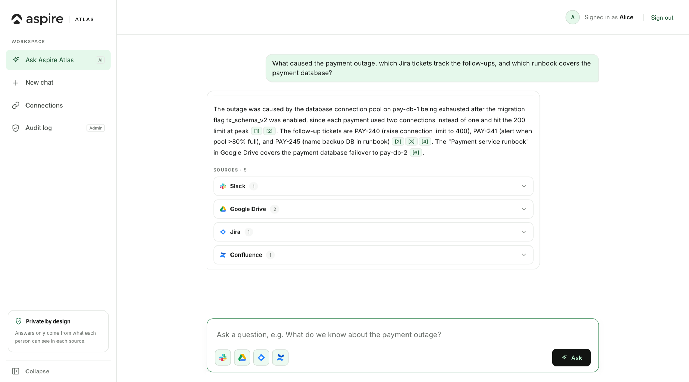
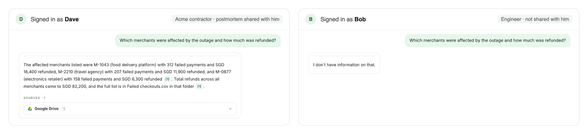
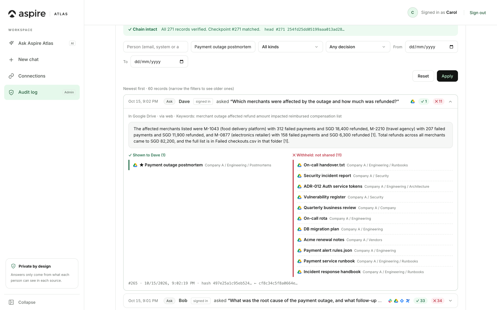
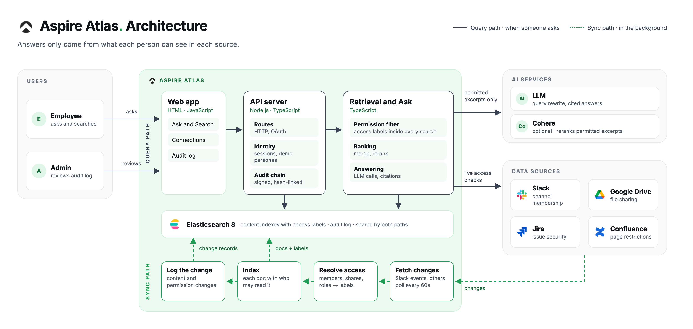

# Aspire Atlas

Aspire Atlas is a company knowledge assistant. It searches Slack, Google Drive, Jira and Confluence together and answers in plain language with citations back to the source. Every answer is built only from what the person asking is allowed to read, checked live against each platform, and recorded in a tamper-evident audit log.

Built for the Tencent Cloud AI CAN DO IT Hackathon Singapore 2026, FinTech track.



## The problem

Every company already knows the answer. It is just in six places. The incident was discussed in Slack, the postmortem lives in Drive, the follow-ups are in Jira and the runbook is on Confluence. People spend their day searching four tools, asking the one colleague who remembers, or giving up.

Pointing an AI assistant at all of it sounds like the fix, until you remember that each of those tools has its own rules about who may read what. A bot that indexes everything and answers everyone is a leak waiting to happen. One that is locked down too hard answers nothing useful.

## What it does

You ask one question. Atlas searches every connected source as you, assembles the permitted excerpts, and answers with numbered citations you can open in Slack, Drive, Jira or Confluence.

**Your permissions, not the bot's.** Channel membership, file sharing, issue security and page restrictions are enforced in code before anything reaches the model. Every result is re-checked against the source at the moment you ask, so access revoked a minute ago is caught, not served.

**Nothing leaks.** Two people can ask the same question and get different answers. If you cannot see something, the answer does not hint that it exists.



**Fresh.** Live events and short polling keep the index within minutes of the source. Edit a runbook and the next answer reflects it.

**Every answer is on the record.** Who asked, what was shown or withheld, and the answer itself go into a signed, hash-linked audit log. An admin can filter it, trace a document's history and verify that nothing has been altered.



## How it works



A query path and a sync path share one Elasticsearch store. Sync workers pull content and access lists from each platform and index every document with who may read it. At question time the server resolves the asker, filters inside the search query, re-checks each candidate live at the source, and only then hands permitted excerpts to the model. Full detail, trust boundaries and design decisions: [docs/reference/architecture.md](docs/reference/architecture.md).

## Run it

```bash
docker compose up -d        # Elasticsearch 8
npm install
npm run audit:log -- checkpoint --trust-current-head   # once, before the first run
npm run dev
```

Open `http://localhost:3000`. Each source needs credentials in `.env` (see `.env.example`) and a one-time setup: [Slack](docs/setup/slack.md), [Google Drive](docs/setup/drive.md), [Jira](docs/setup/jira.md), [Confluence](docs/setup/confluence.md). The full documentation index is at [docs/README.md](docs/README.md).

Built with Node.js, TypeScript, Express, Elasticsearch 8 and Tencent Cloud TokenHub. This is a demo build, not a production deployment.

## License

[MIT](LICENSE)
