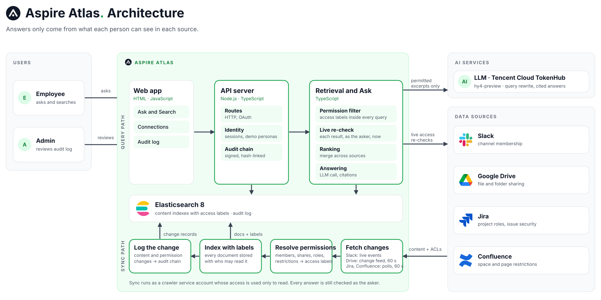

# Architecture

Aspire Atlas imports source content into Elasticsearch, searches it with the asker's permissions, and gives only permitted evidence to the answer model. Each platform keeps its own data format, access rules and sync process; the shared layer never flattens them.

## Request flow

1. The browser sends a question and selected sources. The server resolves the signed-in person, or the selected test persona in Demo mode.
2. The registry calls each configured connector in parallel. Each returns permitted evidence and its per-document audit decisions.
3. The shared layer merges rankings, optionally reranks the permitted evidence, and returns Search results or generates an Ask answer with citations.
4. The app writes the access audit record before returning the result. An audit write failure blocks the response.

## How access is enforced

Permissions decide which evidence can reach the model. The model never decides access.

1. **Resolve the person.** Me mode uses the signed session. Demo mode accepts a selected persona only when `ALLOW_IMPERSONATION=on`.
2. **Resolve access keys.** Each connector maps the person to its own identity and permissions: Slack membership by email, Drive sharing by email, Jira and Confluence by the linked Atlassian account. A missing link means that source returns nothing.
3. **Filter inside the search.** Indexed items carry access labels. Keyword and vector queries include the asker's keys as a filter before any candidate is selected. Sources with two layers (Jira project plus issue security, Confluence space plus page restriction) require both.
4. **Re-check candidates live.** The connector asks the source whether the person can read each candidate right now. Failed or uncertain checks withhold the item, so access revoked after indexing is caught before ranking.
5. **Rank permitted evidence** and, for Ask, send only that evidence to the model with instructions to cite and not to fill gaps.
6. **Write the audit record** before responding.

| Decision in the audit record | Meaning |
| --- | --- |
| Shown | Passed the index filter and live check; selected for the response or answer context |
| Withheld | Matched the admin-only metadata query but failed the index filter |
| Dropped by live re-check | Passed the index filter but failed the current-access check |
| Cited | The generated answer referenced that excerpt |

The index narrows candidates; the live check protects against access removed since indexing. Newly granted access can wait for the next poll or identity refresh before it appears. User-facing pages never list channels, files, projects or spaces before a query, and a refused answer gives no hint that restricted content exists. Platform rules are in the connector references: [Slack](connectors/slack.md), [Drive](connectors/drive.md), [Jira](connectors/jira.md), [Confluence](connectors/confluence.md).

## Audit trail

Every connector writes to one index, `brain-audit`. Each record carries an HMAC-SHA256 over its contents plus the previous record's hash, so the log is a sealed chain. The signing key lives in `.secrets/audit-key` (or `AUDIT_KEY`), never in Elasticsearch.

| Record | Holds |
| --- | --- |
| Search or Ask | Person, question, selected sources, every document decision, and for Ask the answer and citations |
| Permission change | A connector detected a change in indexed access, or received a membership event |
| Content change | An item was added, updated or removed; initial imports use summaries |
| Account | A connection or disconnection |
| Admin | Audit query, chain verification or Sync now |

Change records carry `changed_at` (source time, when the platform exposes it), `detected_at` and `indexed_at`. Detection time is not proof of when an administrator changed access.

**Tamper detection.** A checkpoint file outside Elasticsearch (`.secrets/audit-checkpoint.json`) remembers the latest committed sequence and hash. Before every append the whole chain is verified against it; the pending record is fsynced to the checkpoint before the Elasticsearch insert, so a crash is replayed rather than lost. A failed verification blocks appends, and therefore blocks Search and Ask. This detects edited records, gaps, and deletion of the newest records or the whole log. It does not protect against someone who controls the host, the key or the checkpoint file, and an intact chain proves the stored records are unaltered, not that every source event was captured.

Search and Ask writes are required; sync, account and admin writes are best effort. Audit access needs `ADMIN_TOKEN`. Answers can quote source content, so the log itself is sensitive. Initialisation, verification, backup and repair commands are in the [command reference](commands.md#audit-trail).

## Key design trade-offs

| Decision | Why | What it costs |
| --- | --- | --- |
| Index with access labels, then re-check live | The index gives fast ranked candidates; the live check guarantees current access without rebuilding | One source API call per candidate; newly granted access waits for a poll |
| One crawler service account, asker identity by email or Atlassian link | Index each item once instead of per person | The crawler needs admin-level read; Drive group membership is not expanded |
| Polling at 60 s for Drive, Jira and Confluence; Socket Mode events for Slack | No public endpoint or marketplace app needed for the demo | Freshness is bounded by the poll; Confluence restriction-only changes wait for a 10-minute sweep |
| Filter before the model, return nothing on denial | No restricted text ever reaches the model; no existence leakage | The model cannot explain why it has no information |
| Audit write must succeed before responding | The log is complete for every answer served | Availability is coupled to the audit store |
| Verify the whole chain on every append, checkpoint on local disk | Simple, strong tamper evidence | O(history) per append; production needs incremental verification and remote immutable storage |
| Lexical retrieval by default; embeddings, multi-query and rerank optional | Low cost and no extra vendors unless needed | Semantic recall is lower until embeddings are enabled |
| One My Drive folder as the Drive scope | Matches the demo data | Shared drives and domain-wide delegation are not modelled |

## Components

| Component | Responsibility |
| --- | --- |
| `src/server.ts`, `src/http.ts`, `src/session.ts` | Routes, asker identity, signed sessions and OAuth state |
| `src/connectors/index.ts`, `src/connectors/types.ts` | Registry of configured sources and the shared `Evidence` shape |
| `src/federated.ts` | Cross-source retrieval, ranking, answers and access audit writes |
| `src/search.ts`, `src/events.ts`, `src/sync.ts`, `src/dms.ts` | Slack retrieval and ingestion |
| `src/connectors/{drive,jira,confluence}/` | Platform clients, permissions, indexing and retrieval |
| `src/hybrid.ts`, `src/embeddings.ts`, `src/rerank.ts`, `src/multiQuery.ts` | Optional semantic retrieval and ranking |
| `src/llm.ts`, `src/askRules.ts`, `src/prompts.ts` | Model calls and answer instructions |
| `src/audit/` | Audit types, chain, storage, query API and CLI |

The main UI is `public/index.html`. Account linking and Drive **Sync now** are on `public/connect.html`.

## Limits of this demo

- Demo mode can impersonate test people. Use `ALLOW_IMPERSONATION=off` outside a controlled demo.
- Local credential files and a shared admin token are not a production identity or secrets system.
- Elasticsearch runs in Docker without authentication; bind it to localhost.
- The Drive Sync now route has no admin check; its audit actor is whoever is signed in.
- Index labels can lag behind grants. Live checks remove stale permissions; new grants can need a poll or identity refresh.
